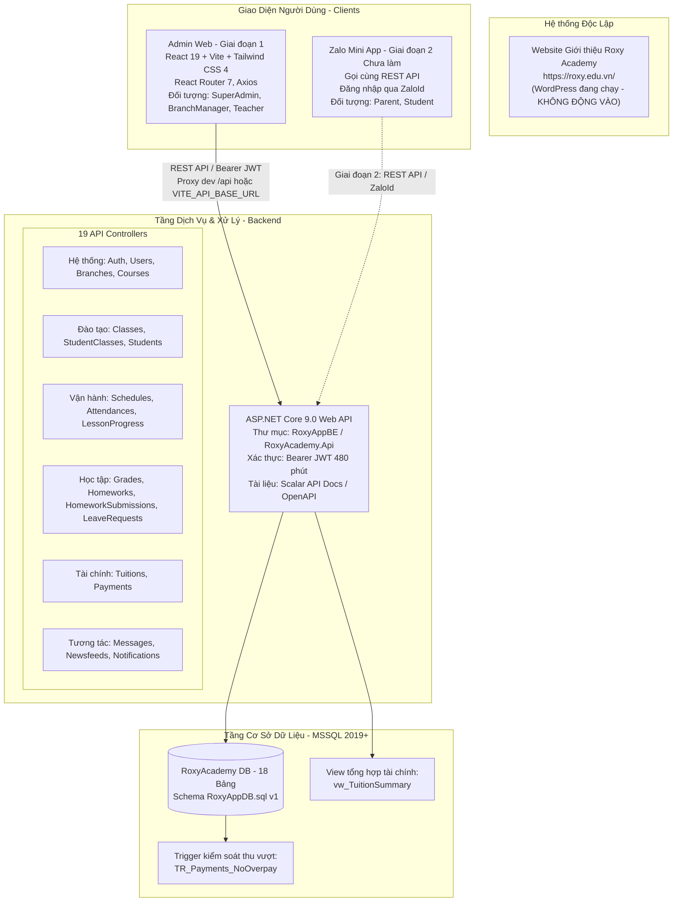

# BÁO CÁO TOÀN DIỆN AUDIT HỆ THỐNG — GIAI ĐOẠN 0
**Dự án:** Roxy Academy — Hệ thống quản lý học tập  
**Phiên bản tài liệu:** 1.0  
**Ngày thực hiện:** 13/11/2026  
**Đơn vị thực hiện:** Nhóm Agent (Architecture, Backend, Frontend, QA)  
**Quy tắc:** Chỉ kiểm tra, đánh giá hiện trạng — KHÔNG sửa đổi code sản phẩm trước khi có phê duyệt của anh Đông.

---

## 1. THÔNG TIN CHUNG & KẾT QUẢ CHẠY THỬ THỰC TẾ

### 1.1. Thông tin nền tảng
- **Thương hiệu:** Roxy Academy — Hệ thống giáo dục trẻ em gần 20 năm, 2 cơ sở tại P. Bình Trưng, TP.HCM. Hotline: 0326 538 824.
- **Web hiện hữu:** https://roxy.edu.vn/ (WordPress đang chạy độc lập — không can thiệp).
- **Hệ thống mới:** Quản lý học tập gồm Admin Web (cho Staff: SuperAdmin, BranchManager, Teacher) và Zalo Mini App (cho Phụ huynh, Học viên).
- **Thứ tự thực hiện:** Web Admin trước (Giai đoạn 1) → Zalo Mini App sau (Giai đoạn 2).

### 1.2. Kết quả kiểm tra chạy thử thực tế (Smoke Test)

| Thành phần | Thao tác kiểm tra | Kết quả thực tế | Đánh giá & Ghi chú |
| :--- | :--- | :---: | :--- |
| **Backend Build** | `dotnet build` tại root repo | **LỖI (Access Denied)** | MSBuild cố ghi vào thư mục gốc `bin/obj` do thiếu cấu hình solution root. |
| **Backend Build** | `dotnet build` tại `RoxyAppBE/RoxyAcademy.Api` | **THÀNH CÔNG (0 Error, 0 Warning)** | Thời gian build ~1.33s trên .NET 9.0 SDK. Code C# biên dịch sạch. |
| **Backend Database** | `sqlcmd -S MSI -d RoxyAcademy` | **LỖI KẾT NỐI (Named Pipes [5])** | SQL Server instance `MSI` chưa khởi chạy hoặc không tồn tại trên môi trường hiện tại. |
| **Backend Secret** | Kiểm tra `Jwt:Key` và `Seed:AdminPassword` | **ĐẠT (Đã bảo vệ local)** | Key đã được chuyển vào .NET User Secrets (`104524be-0867-41cb-8313-096edabe3c39`), không commit file cấu hình nhạy cảm. |
| **Frontend Install** | Kiểm tra thư mục `roxy-admin/node_modules` | **ĐÃ CÓ SẴN** | React 19.3.1, Vite 8.3.4, Tailwind CSS 4.3.3, React Router 7.18.4, Axios 1.20.0. |
| **Frontend Lint** | `npm run lint` tại `roxy-admin/` | **THÀNH CÔNG (0 Error, 0 Warning)** | Mã nguồn JavaScript sạch theo quy chuẩn ESLint. |
| **Frontend Build** | `npm run build` tại `roxy-admin/` | **THÀNH CÔNG** | 85 modules chuyển đổi xong trong 268ms. Output tạo thư mục `dist/`. |
| **Frontend Dev Server** | `npm run dev` tại `roxy-admin/` | **THÀNH CÔNG** | Server Vite khởi chạy ở cổng 5173 trong 390ms, đã dừng tiến trình sau kiểm tra. |

---

## 2. SƠ ĐỒ KIẾN TRÚC HỆ THỐNG HIỆN TẠI



---

## 3. BẢNG TỔNG HỢP AUDIT THEO 4 NHÓM

### Nhóm 1: Đã xong (Completed) — 6 mục
| Thành phần | Vị trí file / Dòng code | Mô tả & Hiện trạng |
| :--- | :--- | :--- |
| **Xác thực Đăng nhập (Auth)** | `RoxyAppBE/.../Controllers/AuthController.cs:1-56` | Đăng nhập bằng SĐT + Password, mã hóa bcrypt/hasher, trả token JWT 480 phút và thông tin UserInfo. |
| **Quản lý Tài khoản (Users)** | `RoxyAppBE/.../Controllers/UsersController.cs:1-217` | Phân quyền `SuperAdmin` (toàn quyền) & `BranchManager` (chỉ quản lý GV/PH thuộc chi nhánh mình). Khóa tài khoản an toàn, chặn xóa GV đang phụ trách lớp chưa kết thúc. |
| **Quản lý Học viên (Students)** | `RoxyAppBE/.../Controllers/StudentsController.cs:1-324` | Chuẩn mẫu thiết kế phân quyền: Lọc dữ liệu theo 5 vai trò; chỉ Staff được xem/sửa `Note`; xóa mềm sang `Dropped`; chặn Giáo viên tạo/sửa hồ sơ học viên. |
| **Quản lý Cơ sở (Branches)** | `RoxyAppBE/.../Controllers/BranchesController.cs:1-88` | Mọi user xem danh sách chi nhánh; chỉ `SuperAdmin` được thêm/sửa/xóa mềm chi nhánh. |
| **Quản lý Khóa học (Courses)** | `RoxyAppBE/.../Controllers/CoursesController.cs:1-96` | Mọi user xem danh sách khóa học; chỉ `SuperAdmin` được thêm/sửa/xóa mềm khóa học. |
| **Thông báo cá nhân (Notifications)** | `RoxyAppBE/.../Controllers/NotificationsController.cs:1-91` | Đọc thông báo cá nhân theo `UserId`, đánh dấu đã đọc / đọc tất cả an toàn. |

### Nhóm 2: Làm dở (In Progress / Incomplete) — 9 mục
| Thành phần | Vị trí file / Dòng code | Hiện trạng & Thiếu sót cụ thể |
| :--- | :--- | :--- |
| **Đăng ký lớp (StudentClasses)** | `StudentClassesController.cs:1-121` | `RegisterClass` thiếu kiểm tra chi nhánh đối với `BranchManager`. DTO `StudentClassDtos.cs:34` validate trạng thái `Finished` nhưng DB quy định `Completed`. |
| **Lịch học (Schedules)** | `SchedulesController.cs:1-71` | API `GetSchedules` bắt buộc truyền `classId`, không hỗ trợ xem theo ngày/tuần/cơ sở; `CreateSchedule` thiếu kiểm tra quyền chi nhánh; thiếu endpoint `PUT`, `DELETE`, `GET /{id}`. |
| **Bài tập (Homeworks)** | `HomeworksController.cs:1-80` | `GetHomeworks` không kiểm tra quyền lớp học; `CreateHomework` thiếu kiểm tra chi nhánh cho `BranchManager`; thiếu các endpoint `PUT`, `DELETE`. |
| **Tiến độ bài học (LessonProgress)** | `LessonProgressesController.cs:1-128` | Lọc dữ liệu xem theo 5 vai trò tốt, nhưng các thao tác thêm/sửa/xóa chưa kiểm tra chi nhánh cho `BranchManager`. |
| **Nghỉ phép (LeaveRequests)** | `LeaveRequestsController.cs:1-148` | `GetLeaveRequests` lọc theo `Class.BranchId` làm mất đơn nghỉ phép của Giáo viên khi `ClassId = null`; `ReviewLeaveRequest` chưa kiểm tra chi nhánh cho Quản lý. |
| **Bản tin (Newsfeed)** | `NewsfeedsController.cs:1-127` | Cho phép `BranchManager` cập nhật đổi chi nhánh bài viết sang cơ sở khác; DTO nhận đối tượng `Parent|Teacher|Student|Staff` nhưng DB quy định `All|Parents|Teachers`. |
| **Trang Đăng nhập Frontend** | `roxy-admin/src/pages/Login.jsx:1-54` | Dùng `axios` trực tiếp thay vì `axiosClient`; chỉ lưu `accessToken` vào `localStorage`, bỏ quên thông tin `user` (role, branchId, fullName); thiếu loading state. |
| **Khung giao diện (AdminLayout)** | `roxy-admin/src/layouts/AdminLayout.jsx:1-54` | Hard-code `Xin chào, Admin`; sidebar `w-64` cố định làm vỡ màn hình mobile; có liên kết `<Link to="/students">` nhưng router chưa khai báo. |
| **Quản lý Lớp (ClassList UI)** | `roxy-admin/src/pages/ClassList.jsx:1-213` | Lệch trường DTO; form tạo lớp thiếu `TeacherId` bắt buộc dẫn đến lỗi 400; thiếu tính năng sửa/xóa/tìm kiếm/phân trang; placeholder sai đối tượng. |

### Nhóm 3: Chưa làm (Not Started) — 7 mục
| Thành phần | Phạm vi | Mô tả chi tiết |
| :--- | :---: | :--- |
| **Màn hình Học viên (Students UI)** | Frontend (Ưu tiên 1 GĐ1) | Chưa có component, view, router, modal thêm/sửa, bộ lọc chi nhánh/trạng thái. |
| **Màn hình Lịch học / Điểm danh UI** | Frontend (Ưu tiên 2 GĐ1) | Chưa có giao diện lịch tuần/ngày và bảng điểm danh số lượng lớn (Bulk Attendance). |
| **Màn hình Học phí / Thu tiền UI** | Frontend (Ưu tiên 3 GĐ1) | Chưa có danh sách công nợ, giao diện xác nhận chuyển khoản và đính kèm biên lai. |
| **Màn hình Bài tập (Homework UI)** | Frontend (Ưu tiên 4 GĐ1) | Chưa có giao diện giao bài tập, chấm điểm và xem file nộp. |
| **Màn hình Nghỉ phép (Leave UI)** | Frontend (Ưu tiên 5 GĐ1) | Chưa có giao diện gửi đơn và phê duyệt đơn nghỉ học/nghỉ dạy. |
| **Backend Dashboard API** | Backend | Chưa có `DashboardController.cs` để tổng hợp số liệu thống kê thật theo chi nhánh. |
| **Phân quyền Route (Role Guard UI)** | Frontend | `ProtectedRoute.jsx` mới chỉ kiểm tra token tồn tại, chưa chặn route theo vai trò người dùng. |

### Nhóm 4: Rủi ro nghiêm trọng (Risks & Vulnerabilities) — 6 mục
| Vấn đề | Vị trí file / Dòng code | Hậu quả & Mức độ rủi ro |
| :--- | :--- | :--- |
| **Lộ toàn bộ tin nhắn nội bộ** | `RoxyAppBE/.../MessagesController.cs:20-63` | **CRITICAL:** Khi gọi `GET /api/Messages?type=all`, truy vấn không lọc điều kiện người nhận/gửi, làm lộ toàn bộ tin nhắn bảo mật của hệ thống. |
| **Lộ danh sách học phí & thanh toán** | `TuitionsController.cs:20-50` & `PaymentsController.cs:21-49` | **CRITICAL:** Không lọc vai trò `Teacher` và `Student`, dẫn đến học viên hoặc giáo viên có thể tra cứu toàn bộ số tiền học phí và thanh toán của người khác. |
| **CORS mở toàn bộ (AllowAll)** | `RoxyAppBE/.../Program.cs:16-24, 111` | **CRITICAL:** Cho phép mọi origin, method, header trên cả môi trường Production. Vi phạm luật `GEMINI.md`. |
| **Điểm danh xuyên chi nhánh** | `AttendancesController.cs:21-35, 38-96` | **HIGH:** `GetAttendances` không phân quyền; `BulkMarkAttendance` không chặn Quản lý cơ sở này điểm danh cho cơ sở khác. |
| **Xung đột Trigger Payments với EF Core** | `RoxyAppBE/.../PaymentsController.cs:87` | **HIGH:** Bảng `Payments` có trigger `TR_Payments_NoOverpay`. Nếu EF Core thực thi câu lệnh INSERT có mệnh đề `OUTPUT` mà không tắt qua `UseSqlOutputClause(false)`, lệnh lưu sẽ bị SQL Server ngắt lỗi. |
| **Lỗi chặn 100% Form tạo lớp** | `roxy-admin/src/pages/ClassList.jsx:13-21, 140-207` | **BLOCKER:** Form không có ô chọn Giáo viên và không gửi `TeacherId`. Backend bắt buộc `TeacherId` phải có, dẫn đến việc người dùng không thể tạo lớp từ giao diện. |

---

## 4. ĐỐI CHIẾU 7 MỤC TRONG §3 BRIEF-ADMIN-WEB.MD

| STT | Phân hệ nghiệp vụ | Hiện trạng Backend API | Hiện trạng Admin Web UI | Đánh giá tổng quát |
| :-: | :--- | :--- | :--- | :---: |
| **1** | **Students (Ưu tiên 1)** | **ĐÃ CÓ ĐẦY ĐỦ** (100%): GET, GET/{id}, POST, PUT, DELETE, POST account, POST reset-pass. Phân quyền chuẩn mẫu. | **CHƯA CÓ GÌ** (0%): Mới chỉ có đường link chết trên Sidebar `AdminLayout.jsx`. | **Trọng tâm số 1 cần làm ngay ở Giai đoạn 1.** |
| **2** | **Schedules / Attendance** | **CƠ BẢN** (60%): Đã có bulk attendance, create schedule. Thiếu lọc lịch theo ngày/tuần, thiếu update/delete schedule. | **CHƯA CÓ GÌ** (0%). | Cần bổ sung API query lịch theo tuần trước khi dựng UI. |
| **3** | **Tuitions / Payments** | **CƠ BẢN** (60%): Có tạo hóa đơn, xác nhận tiền. Hở quyền xem đối với Học viên/Giáo viên; chưa dùng view tổng hợp. | **CHƯA CÓ GÌ** (0%). | Cần vá phân quyền backend trước khi làm màn hình thu ngân. |
| **4** | **Homework** | **CƠ BẢN** (60%): Tạo bài tập tự sinh submission, chấm bài. Thiếu quyền cho Học viên nộp bài; thiếu sửa bài tập. | **CHƯA CÓ GÌ** (0%). | Cần mở role Student nộp bài cho giai đoạn App sau này. |
| **5** | **LeaveRequests** | **CƠ BẢN** (75%): Tạo đơn, duyệt đơn. Cần sửa logic lọc đơn của GV khi không gắn lớp; bổ sung check chi nhánh. | **CHƯA CÓ GÌ** (0%). | Backend tương đối sẵn sàng, sẵn sàng dựng UI ở Giai đoạn 1. |
| **6** | **Dashboard** | **CHƯA CÓ API** (0%): Chưa có `DashboardController`. | **CÓ GIAO DIỆN GIẢ** (10%): Đang hard-code số liệu bịa (120 học viên, 15 lớp, 45tr). | Làm CUỐI CÙNG theo đúng quy định trong BRIEF. |
| **7** | **Messages / Newsfeed / Notif** | **CƠ BẢN** (70%): Đủ API nhưng Messages hở bảo mật nghiêm trọng; Newsfeed lệch enum đối tượng nhận tin. | **CHƯA CÓ GÌ** (0%). | Chỉ làm khi 6 mục trên hoàn tất. |

---

## 5. CHI TIẾT KIỂM TRA BACKEND (19 CONTROLLERS & DB)

### 5.1. Bảng phân tích chi tiết 19 Controllers

| Controller | Phân quyền hiện tại | Đánh giá an toàn | Lỗi logic / Check constraint lệch DB |
| :--- | :--- | :---: | :--- |
| **AuthController** | `AllowAnonymous` (login), `Authorize` (me) | **TỐT** | Dòng 48 dùng `User.FindFirstValue("sub")` thay vì hàm extension `User.GetUserId()`. |
| **UsersController** | `SuperAdmin, BranchManager` | **TỐT** | Kiểm soát chi nhánh chặt chẽ. Đã chặn tự xóa tài khoản và chặn khóa GV đang dạy lớp đang mở. |
| **StudentsController** | Cả 5 vai trò theo phạm vi chuẩn | **CHUẨN MẪU** | `CanSeeNote` và `Mask()` hoạt động chính xác. Phụ huynh/Học sinh không thấy `Note`. GV bị chặn tạo/sửa. |
| **BranchesController** | Đọc: All; Ghi: `SuperAdmin` | **TỐT** | Xóa mềm `IsActive = false`. Chuẩn. |
| **CoursesController** | Đọc: All; Ghi: `SuperAdmin` | **TỐT** | Xóa mềm `IsActive = false`. Chuẩn. |
| **NotificationsController** | Đọc: Chính mình; Tạo: `SuperAdmin` | **TỐT** | Không rò rỉ thông báo người khác. |
| **ClassesController** | Đọc: All; Ghi: `SuperAdmin` | **RỦI RO CAO** | 1. Đọc không lọc chi nhánh.<br>2. Xóa cứng `db.Classes.Remove` gây lỗi FK.<br>3. `ClassType` mặc định `"Offline"` lệch `CK_Classes_Type ('Group','OneToOne')`.<br>4. L48 tiềm ẩn lỗi NullReferenceException nếu User null. |
| **StudentClassesController** | Phân quyền xem đủ 5 vai trò | **TRUNG BÌNH** | 1. `RegisterClass` không kiểm tra `BranchManager` có quản lý chi nhánh của lớp/học viên không.<br>2. DTO nhận `Finished` nhưng DB yêu cầu `Completed`. |
| **SchedulesController** | Xem: All; Tạo: Staff + GV | **RỦI RO** | 1. `GetSchedules` bắt buộc `classId`, không có lọc chi nhánh/ngày/tuần.<br>2. `CreateSchedule` không kiểm tra chi nhánh cho `BranchManager`.<br>3. Thiếu các API cập nhật/xóa lịch. |
| **AttendancesController** | Xem: All; Điểm danh: Staff + GV | **RỦI RO CAO** | 1. `GetAttendances` không phân quyền.<br>2. `BulkMarkAttendance` không kiểm tra `schedule.Class.BranchId == userBranchId` cho `BranchManager`.<br>3. DTO dùng `Absent|Excused` lệch DB `('Present','Late','ExcusedAbsent','UnexcusedAbsent')`. |
| **LessonProgressesController** | Xem: 5 vai trò; Ghi: Staff + GV | **TRUNG BÌNH** | Thao tác Thêm/Sửa/Xóa thiếu kiểm tra `Class.BranchId` cho `BranchManager`. |
| **HomeworksController** | Xem: All; Tạo: Staff + GV | **TRUNG BÌNH** | `GetHomeworks` không kiểm tra quyền lớp; `CreateHomework` thiếu kiểm tra chi nhánh cho `BranchManager`. |
| **HomeworkSubmissionsController** | Nộp: SA + Parent; Chấm: Staff + GV | **RỦI RO** | 1. `SubmitHomework` thiếu role `Student`.<br>2. `GetSubmissions` quên lọc `Student`.<br>3. `ReviewHomework` thiếu kiểm tra quyền GV và gợi ý `"Evaluated"` lệch DB `('Pending','Submitted','Reviewed')`. |
| **GradesController** | Xem: PH, GV, BM; Nhập: Staff + GV | **RỦI RO** | 1. `GetGrades` quên lọc `Student` (học sinh xem được điểm cả trường).<br>2. Thêm/Sửa điểm thiếu kiểm tra chi nhánh cho `BranchManager`.<br>3. DTO dùng `"15Min"` lệch DB `('Quiz','Midterm','Final','Daily','Other')`. |
| **LeaveRequestsController** | Xem: 5 vai trò; Tạo: 5 vai trò; Duyệt: SA, BM | **CHUẨN MẪU** | **ĐÃ SỬA (GĐ 1F):**<br>1. Phân quyền `BranchManager` lọc cả `Class`, `Student`, `Teacher` không làm mất đơn GV khi `ClassId` null.<br>2. `ReviewLeaveRequest` kiểm tra chi nhánh chặt chẽ cho `BranchManager` và liên kết tự động `Attendances` (`ExcusedAbsent`). |
| **TuitionsController** | Xem: PH, BM; Ghi: SA, BM | **RỦI RO CAO** | 1. `GetTuitions` quên chặn/lọc `Teacher` và `Student`.<br>2. `GetTuition(id)` không kiểm tra chi nhánh của `BranchManager`.<br>3. Chưa dùng view `vw_TuitionSummary` để kiểm soát trạng thái thực tế. |
| **PaymentsController** | Xem: PH, BM; Ghi: SA, BM, PH | **RỦI RO CAO** | 1. `GetPayments` quên chặn/lọc `Teacher` và `Student`.<br>2. Bảng có trigger `TR_Payments_NoOverpay`, cần kiểm tra cấu hình DbContext để tránh crash EF Core. |
| **NewsfeedsController** | Xem: Công khai; Ghi: SA, BM | **TRUNG BÌNH** | `UpdateNewsfeed` cho phép `BranchManager` đổi `BranchId` sang chi nhánh khác; DTO nhận `TargetAudience` lệch DB `('All','Parents','Teachers')`. |
| **MessagesController** | Xem: Inbox/Outbox/Class; Gửi: All | **CRITICAL** | 1. Lỗi hở toàn bộ tin nhắn hệ thống khi `type` khác "inbox/outbox/class".<br>2. Tin nhắn lớp (`type=class`) quên lọc `Student` và `BranchManager`.<br>3. `SendMessage` không kiểm tra quyền người gửi đối với `ClassId`. |

---

## 6. CHI TIẾT KIỂM TRA FRONTEND (`roxy-admin/`)

### 6.1. Cấu hình & Biến môi trường
- `roxy-admin/vite.config.js`: Proxy cứng `/api` về `http://localhost:5123`.
- `roxy-admin/src/api/axiosClient.js`: `baseURL: '/api'`. Chưa sử dụng biến môi trường `import.meta.env.VITE_API_BASE_URL`.
- `roxy-admin/index.html`: Thẻ tiêu đề đang để `<title>roxy-admin</title>` và `<html lang="en">`. Cần đổi sang tiếng Việt (`lang="vi"`) và tiêu đề thương hiệu chuẩn: `Roxy Academy — Quản trị học tập`.

### 6.2. Mã nguồn rác & Lỗi CSS vỡ giao diện
- **Lỗi ép độ rộng khung hình:** `roxy-admin/src/index.css` (dòng 58-68) chứa đoạn mã template Vite:
  ```css
  #root {
    max-width: 1280px;
    margin: 0 auto;
    padding: 2rem;
    text-align: center;
  }
  ```
  Đoạn CSS này làm hỏng toàn bộ bố cục toàn màn hình của trang Quản trị (Admin Dashboard), khiến nội dung bị co cụm ở giữa và canh giữa chữ không đúng chuẩn.
- **File rác template:** `src/App.css` (184 dòng CSS demo của Vite), `src/assets/hero.png`, `src/assets/react.svg`, `src/assets/vite.svg` không được dùng tới.

### 6.3. Chi tiết các trang & thành phần giao diện
1. **Trang Đăng nhập (`Login.jsx`):**
   - Import trực tiếp thư viện `axios` thay vì `axiosClient`, làm mất tác dụng của các interceptor xử lý lỗi và cấu hình tập trung.
   - Khi đăng nhập thành công, chỉ lưu mỗi `accessToken` vào `localStorage`, bỏ quên thông tin người dùng (`user: { fullName, role, branchId }`). Vì vậy toàn bộ hệ thống không biết ai đang đăng nhập và thuộc chi nhánh nào.
   - Thiếu trạng thái `loading` trên nút bấm, người dùng có thể click liên tục nhiều lần.
2. **Khung giao diện chính (`AdminLayout.jsx`):**
   - Header hiển thị cố định dòng chữ `Xin chào, Admin` thay vì tên và vai trò của người đăng nhập.
   - Thanh Menu điều hướng cố định trạng thái Active tại mục "Tổng quan".
   - Menu chứa mục `🎓 Học viên` trỏ về đường dẫn `/students`, nhưng `App.jsx` chưa khai báo route này (click vào ra trang trắng).
   - Thanh Sidebar có độ rộng cứng `w-64`, không có nút đóng mở (drawer) trên Mobile làm giao diện bị co ép, tràn màn hình trên điện thoại.
3. **Màn hình Tổng quan (`Dashboard.jsx`):**
   - Toàn bộ nội dung là số liệu giả hard-code: 120 học viên, 15 lớp, 45,000,000đ doanh thu. Vi phạm tiêu chuẩn nghiệm thu và luật của dự án.
4. **Màn hình Lớp học (`ClassList.jsx`):**
   - **Lỗi chặn thao tác:** Form tạo lớp không có trường chọn Giáo viên (`TeacherId`). Backend yêu cầu bắt buộc `TeacherId`, dẫn đến khi submit chắc chắn bị lỗi 400.
   - Lệch trường dữ liệu: DTO backend dùng `MaxStudents` nhưng giao diện dùng `maxCapacity`.
   - Bảng danh sách hiển thị sai dữ liệu: Đọc `cls.classCode` (không có trong API), đọc `cls.currentCapacity / cls.maxCapacity` (không tồn tại), khiến cột sĩ số luôn hiển thị `0 / 0`.
   - Placeholder sai ngữ cảnh đối tượng đào tạo: Ghi gợi ý `VD: Lớp IELTS 6.5 Tối 2-4-6` trong khi trung tâm phục vụ trẻ em từ mầm non đến phổ thông với các khóa kỹ năng, tư duy, luyện chữ.
   - Thiếu toàn bộ các tính năng cơ bản: Sửa lớp, Xóa lớp, Tìm kiếm, Lọc theo chi nhánh, Phân trang dữ liệu.

---

## 7. RỦI RO BẢO MẬT, DEPLOYMENT & MA TRẬN TEST CASES CHO GIAI ĐOẠN 1

### 7.1. Danh mục rủi ro trước khi triển khai (Pre-Deploy Checklist)
1. **CORS:** Phải thay thế chính sách `AllowAll` bằng danh sách Origin cho phép:
   - `http://localhost:5173` (Dev)
   - `https://admin.roxy.edu.vn` (Admin Web Production)
   - `https://roxy.edu.vn` (WordPress Landing Page)
   - Domain Zalo Mini App.
2. **Chuỗi kết nối DB:** Chuyển `Server=MSI;Database=RoxyAcademy;...` trong `appsettings.json` thành cấu hình template mẫu; nạp chuỗi kết nối thật của hosting qua biến môi trường `ConnectionStrings__Default`.
3. **Khởi tạo dữ liệu SuperAdmin:** Logic seed trong `Program.cs` cần được tách riêng hoặc cấu hình để có thể chạy được khi triển khai Database mới trên Production, tránh tình trạng không có tài khoản quản trị để đăng nhập.
4. **Vá lỗ hổng MessagesController:** Phải bổ sung ngay điều kiện bắt buộc `ReceiverId == UserId || SenderId == UserId` trong mọi trường hợp truy vấn.

### 7.2. Ma trận Test Cases QA ưu tiên bắt buộc kiểm thử ở Giai đoạn 1

| Mã Test Case | Phân hệ kiểm thử | Vai trò thực hiện | Thao tác kiểm thử chi tiết | Kết quả mong đợi (Chuẩn nghiệm thu QA) |
| :--- | :--- | :--- | :--- | :--- |
| **TC-STU-01** | Hồ sơ học viên | `Parent` | Gọi API `GET /api/Students` và `GET /api/Students/{id}` | Trường `Note` bắt buộc trả về `null`. Không để lộ bệnh lý/tự kỷ của trẻ. |
| **TC-STU-02** | Hồ sơ học viên | `Parent` | Gửi dữ liệu có `note: "Ghi chú lậu"` qua POST / PUT | Database lưu `Note = NULL`. Phụ huynh không thể can thiệp ghi chú nội bộ. |
| **TC-STU-03** | Hồ sơ học viên | `Teacher` | Bấm nút Thêm hoặc Sửa thông tin học viên trên giao diện | Trả về lỗi `403 Forbidden`. Giáo viên chỉ được xem danh sách học viên lớp mình. |
| **TC-STU-04** | Hồ sơ học viên | `BranchManager` Cơ sở 1 | Cố tình truy cập hoặc sửa học viên thuộc Cơ sở 2 | Trả về `404 Not Found` hoặc `403 Forbidden`. Phân quyền chi nhánh tuyệt đối. |
| **TC-STU-05** | Quản lý Lớp học | `BranchManager` Cơ sở 1 | Cố tình chọn chi nhánh Cơ sở 2 khi tạo lớp học | Bị chặn từ giao diện và Backend trả về `403 Forbidden`. |
| **TC-FIN-01** | Học phí & Thu tiền | `Student` / `Teacher` | Gọi API `GET /api/Tuitions` hoặc `GET /api/Payments` | Bị từ chối truy cập (403) hoặc chỉ thấy đúng dữ liệu của bản thân (Student). |
| **TC-MSG-01** | Tin nhắn nội bộ | Bất kỳ User | Gọi API `GET /api/Messages?type=all` hoặc truyền type lạ | Hệ thống từ chối hoặc chỉ trả về tin nhắn liên quan tới `UserId` hiện tại. |
| **TC-MOB-01** | Giao diện Responsive | Mọi vai trò | Truy cập Admin Web trên màn hình điện thoại (chiều rộng 375px - 414px) | Menu tự thu gọn thành Drawer / Hamburger, bảng dữ liệu cuộn ngang, không vỡ layout. |

---

## 8. CÂU HỎI CẦN ANH BẢO & ANH ĐÔNG XÁC NHẬN

1. **Gửi anh Bảo (Quản trị Hosting):**
   - Tên database chính thức và thông tin đăng nhập SQL Server (User / Password / Port) là gì?
   - Môi trường hosting hỗ trợ đặt Biến môi trường (Environment Variables) qua IIS/Plesk UI hay cần file `appsettings.Production.json` riêng?
   - Hai subdomain `api.roxy.edu.vn` và `admin.roxy.edu.vn` đã hoàn tất trỏ DNS và cài đặt chứng chỉ SSL chưa?
2. **Gửi anh Đông (Quản lý dự án):**
   - Khi tạo lớp học mới, có bắt buộc phải phân công Giáo viên phụ trách ngay không, hay cho phép tạo lớp trước rồi gán Giáo viên sau (`TeacherId` có thể null)?
   - Danh sách khóa học ban đầu của trung tâm gồm những môn nào để chuẩn bị dữ liệu danh mục chuẩn cho dropdown tạo lớp?
   - Xác nhận thứ tự làm tiếp theo: Bắt tay vào hoàn thiện trọn vẹn màn hình **Students (Ưu tiên 1)** cho Admin Web theo đúng tiêu chuẩn thiết kế Apple/Emil.
